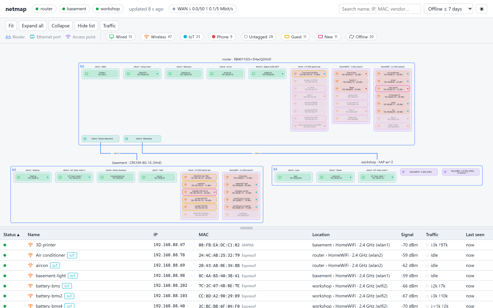
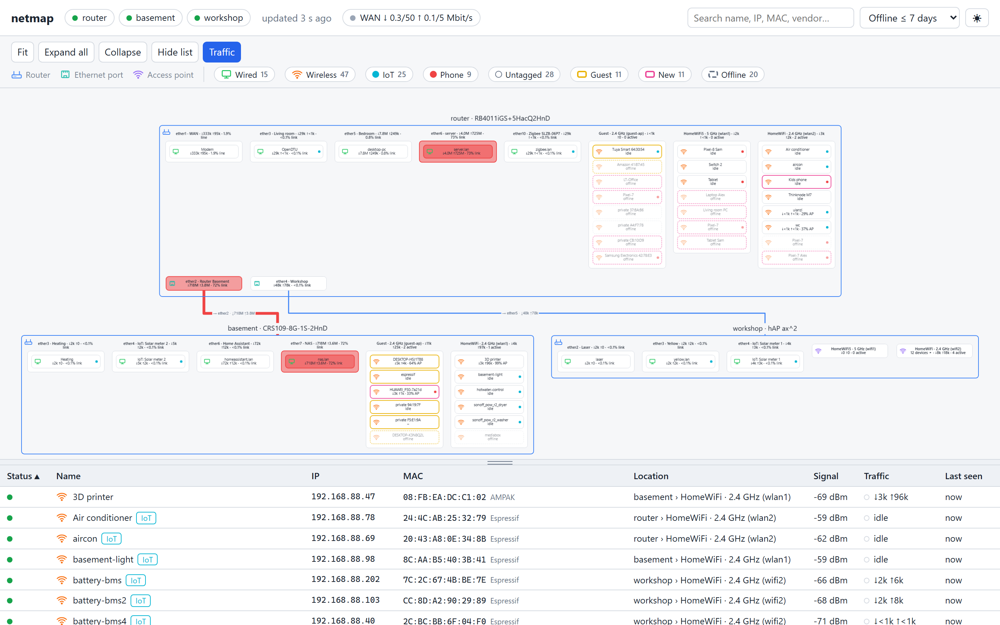
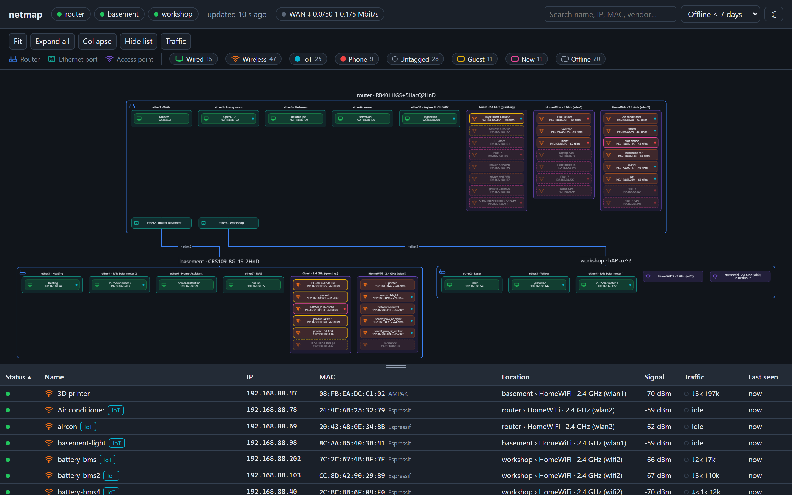
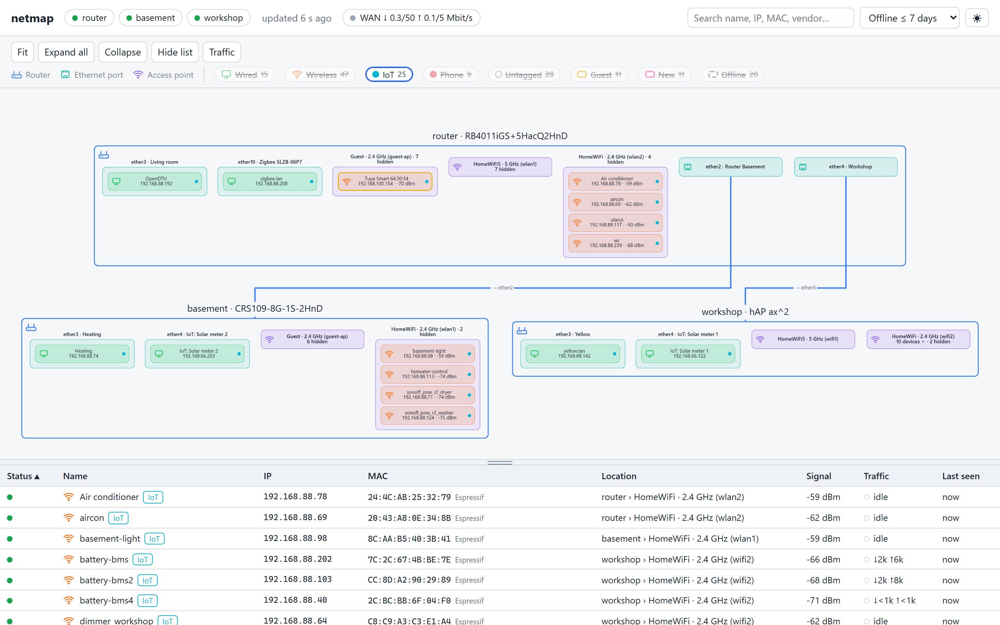
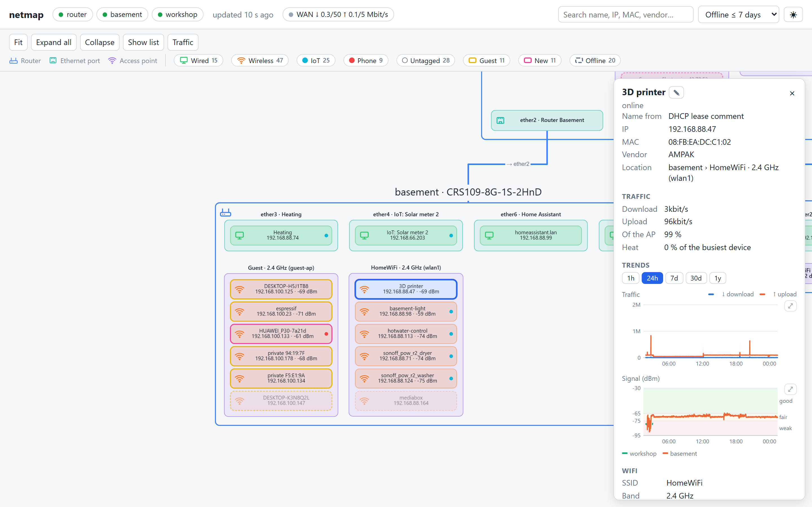
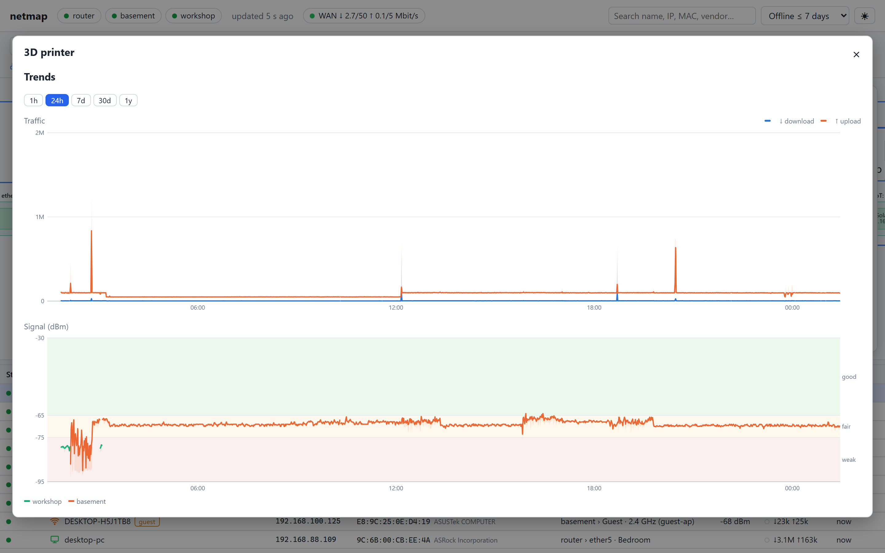
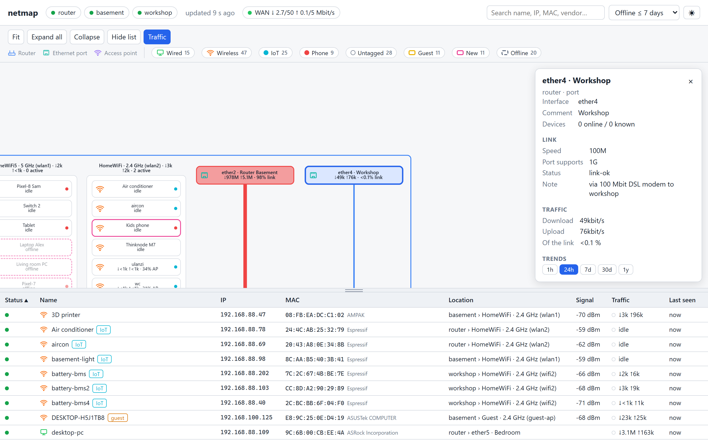
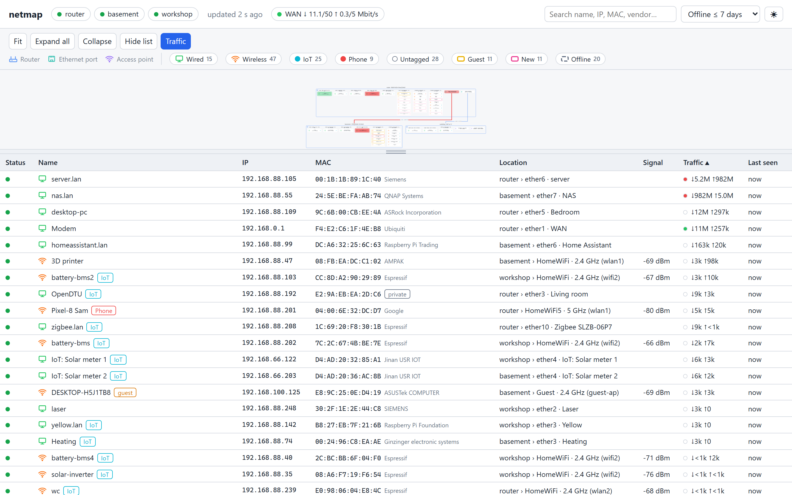

# netmap

A live map of a MikroTik home network: which device sits on which router port or access point,
with its name, IP, vendor, wifi signal and current traffic, plus a history of traffic and signal.
netmap polls the routers every 10 s through a **read-only** API-SSL user and never changes anything
on them.

It runs as a small Python service (`librouteros` + PyYAML, standard-library web server) with a
single-page web UI (Cytoscape.js, bundled), e.g. on a Raspberry Pi or any Linux box in the network.

**Requirements**
- RouterOS 6 or 7 on every router (local `wireless`, v6 CAPsMAN and v7 `wifi` are supported)
- API-SSL enabled on every router (see [Router setup](#router-setup))
- Python 3 (tested with 3.13 and 3.14) and the `openssl` command for the self-signed web certificate



## Contents
- [Screenshots](#screenshots)
- [What you see](#what-you-see)
- [Where the names come from](#where-the-names-come-from)
- [How netmap works](#how-netmap-works)
- [Configuration](#configuration)
- [Router setup](#router-setup)
- [Running, deploying, testing](#running-deploying-testing)
- [Own CA (optional)](#own-ca-optional)
- [Files and API](#files-and-api)
- [Troubleshooting](#troubleshooting)
- [Ideas](#ideas)
- [License](#license)

## Screenshots

From a real network, with names, MACs and IPs replaced (see [tools/demo_proxy.py](tools/demo_proxy.py)).

| | |
|---|---|
| [](docs/screenshots/traffic.png) **Traffic**: heat on devices, ports and links | [](docs/screenshots/overview-dark.png) **Dark theme** |
| [](docs/screenshots/filter-iot.png) **Filter**: only IoT devices (double-click in the legend) | [](docs/screenshots/device.png) **Device details** with traffic and signal history; the signal is colored by AP, so roaming shows |
| [](docs/screenshots/chart.png) **Trends**, enlarged | [](docs/screenshots/port.png) **Port details**: link speed, known bottleneck, traffic |
| [](docs/screenshots/list.png) **List** sorted by traffic | |

## What you see

**Header**
- One chip per router (green = reachable; click for its details). The **WAN** chip shows current
  download/upload against the line speed (`traffic.wan`), colored by how full the line is.
- **Certificates** chip (only with `cert_watch`): green when all watched TLS services are fine,
  amber before one expires, red when one isn't trusted or can't be reached.
- Search box: filters the table and highlights matching devices on the map (name, IP, MAC, vendor,
  host name, tags, location).
- *Offline ≤ N days*: how long offline devices stay visible.
- **◐ / ☀ / ☾** (top right): theme. Auto follows the operating system; click to switch to light or
  dark. Remembered per browser.

**Map**
- Each router is a card. Inside are its **Ethernet ports** and **access points** (one card per
  SSID and radio, e.g. "HomeWiFi · 2.4 GHz (wlan2)"), and inside those the **devices**.
- Ports leading to another router are drawn last in the card; a line runs to the child router,
  labeled with the child's port (e.g. "→ ether5").
- Ports and APs with more than 8 devices start collapsed ("23 devices ▸"); click a card twice to
  expand/collapse it, or use *Expand all* / *Collapse*.
- Device pills: icon and tint show wired vs. wireless, colored dots on the right show tags, the
  border shows guest (yellow), new in the last 24 h (pink), offline (dashed, faded).
- *Fit* zooms to everything; *Hide list* gives the map the full height; drag the divider above
  the table to resize it (double-click resets).

**Legend = filter** (toolbar row above the map)
- Router / Ethernet port / Access point explain the shapes.
- Wired, Wireless, each tag, Untagged, Guest, New, Offline are filters with counts. **Click** an
  item to hide those devices, **double-click** to show only them (double-click again to reset).
  Applies to map and table. A port whose devices are all hidden disappears; AP cards say how many
  devices are hidden.

**Traffic** (toolbar button)
- Colors devices, ports, APs and router-to-router lines by current traffic ("heat"); pills show
  `↓ 3.2M ↑ 140k · 12% link` (or `% AP` for wifi, `% line` on the WAN).
- Heat is **relative**: compared with the busiest device (devices) or the busiest port/AP
  (infrastructure) in the last minutes, so the top talkers stand out. The WAN port and the modem
  behind it use the **absolute** share of the line speed instead.
- Devices sharing one port (behind a switch) are shown as *shared port*: their own traffic can't be
  measured, only the port's.

**Details panel** (click a device, port, AP or router)
- Device: name and where it comes from, IPs, MAC, vendor (or *private* for random MACs), host name,
  location, traffic, tags (with the rule that matched), wifi (SSID, band, signal, rates), DHCP lease,
  neighbor-discovery data, first/last seen.
  Click the **name, an IP, the MAC, the host name or the SSID** to copy it ("✓ copied"; also
  Tab + Enter, and inside an iframe embed). ✎ next to the name renames the device.
  An offline device that no router knows any more has **Forget device…** (see *Forgetting*);
  otherwise the panel says what still holds it (e.g. a static DHCP lease).
- Port: link speed, what the port supports, a warning when a router-to-router link negotiated
  below what both ends support (unless explained by `traffic.link_limits`).
- **Trends**: traffic (↓/↑ with a band for the peaks) and, for wifi devices, signal (colored by the
  router the device was on, so roaming shows as a color change). Ranges 1h / 24h / 7d / 30d / 1y,
  hover for exact values, **⤢** opens a large view (Esc closes).

**Table**: all visible devices, sortable by any column (status, name, IP, MAC, location, signal,
traffic, last seen). Click a row to select the device on the map.

## Where the names come from

**Devices**: the first of these that exists wins; the details panel shows which one (*Name from*):

| # | Source | How to set it |
|---|---|---|
| 1 | **Name given in netmap's UI** ("netmap (UI)") | ✎ next to the name in the device's details; empty = back to the automatic name. Stored in `data/netmap.db`, the routers are not touched |
| 2 | **`names:` in `config.yaml`** ("netmap (config)") | `names: {"02:00:00:00:00:01": "Garden socket"}`; needs a restart |
| 3 | **DHCP lease comment** on the router running the DHCP server | WinBox: IP → DHCP Server → Leases → *Make Static*, then set *Comment*. CLI: `/ip dhcp-server lease make-static [find mac-address=AA:BB:…]` and `/ip dhcp-server lease set [find mac-address=AA:BB:…] comment="Living room TV"` |
| 4 | **Static DNS name** for the device's IP | `/ip dns static add name=tv.lan address=192.168.88.50` (the IP should be fixed, i.e. a static lease) |
| 5 | **DHCP host name** the device sends itself | Set on the device (e.g. ESPHome/Tasmota hostname, phone/PC name) |
| 6 | **Vendor + last 3 bytes of the MAC** ("Espressif AA:83:E7"), or *private …* for random MACs, *unknown …* if the vendor isn't known | Automatic, from the IEEE OUI list (refreshed monthly) |

A device that is offline and no longer has a lease keeps the name it had when it was last seen
(*last known*). Names from netmap (1, 2) need no static lease, follow the device by MAC whatever IP
it gets, and protect it from being forgotten (`forget_private_after_days`), as do a lease comment or
a static lease. RouterOS only allows a lease comment on a static lease. A static DNS name (4) follows
the IP, so it only fits devices with a fixed IP.

Renaming and forgetting devices are the only things netmap's UI writes (to its own database). The
`api/name` and `api/forget` endpoints need the login and an `X-Netmap: 1` header, so other websites
can't trigger them through a logged-in browser.

**Routers**: `name` in `config.yaml` (default: the first label of `host`). The RouterOS identity is
shown in the router's details only, and routers are recognized by MAC, so renaming the identity
changes nothing in netmap.

**Ports**: interface name plus the interface **comment** on the router, e.g. "ether3 · Living room"
(`/interface ethernet set ether3 comment="Living room"`).

**Access points**: SSID · band (interface), e.g. "HomeWiFi · 2.4 GHz (wlan2)"; radios managed by v6
CAPsMAN show "(CAPsMAN)" and are drawn under the router that physically has the radio.

**Tags**: the keys under `tags:` in `config.yaml`.

## How netmap works

**Data.** Each poll reads, per router: identity/resources, interfaces (with byte counters), bridges,
bridge ports and the bridge host table (MAC → port), neighbor discovery, DHCP servers and leases,
ARP, static DNS, Ethernet ports, and the wifi tables of all three RouterOS flavors (v6 local
`wireless`, v6 CAPsMAN, v7 `wifi`). Every 60 s it also reads the negotiated Ethernet link speed
(`/interface ethernet monitor … once`). Only `print`/`monitor` commands are used. Menus a router
doesn't have are skipped. One persistent API session per router (RouterOS logs every login).

**Router tree.** All interface MACs of all routers are collected. A router's port on which another
router's MACs show up in the bridge host table is an *uplink* toward that router. With `root` at the
top, each router's parent is the router on its root-side port that doesn't itself see another of
those routers on its port toward the child; neighbor discovery alone would also report routers
reachable *through* another bridge. `links:` in the config overrides this. Router MACs are
remembered across polls, so a router that is briefly unreachable (reboot) doesn't turn into
"devices" on its parent's port.

**Where a device is.**
1. A wifi registration (any AP, any RouterOS flavor) wins.
2. Otherwise a bridge host entry on a non-uplink port. Entries on VLAN interfaces (e.g. a guest
   VLAN between two routers) are links, not locations: a device seen only there is online but its
   location is unknown.
3. Otherwise ARP on a routed (non-bridge) port, e.g. the modem on the WAN port.

**Online / offline / new.** Online = in one of those tables now (bridge entries expire about 5 min
after a device's last frame), with `offline_after` seconds of grace. Every device ever seen is kept in
`data/netmap.db` with first/last seen and last location. *New* = first seen less than 24 h ago; the
very first poll after setting up netmap is the baseline and doesn't count as new.

**Guest.** A device is a guest when its DHCP server, its port/AP or that port's bridge has a name
containing `guest_pattern` (default `guest`).

**Wifi signal.** The strength at which the AP hears the client. On RouterOS v6 netmap uses the
median over all data rates heard in the last minute: v6 reports the last frame only, and some rates
(seen: 11 Mbit/s on an AR9300 radio) read 15–20 dB low. v7 reports a steady value itself.

**Traffic.** Rates are the byte-counter difference between two polls, from the attached device's
point of view (a port's *tx* is the device's download). Heat = rate ÷ a reference that follows the
busiest device (or port/AP), halves every `half_life_s` and never drops below `floor_mbps`; the
`bands` map heat % to colors.

**History.** Per device (by MAC), per port/AP (by router + interface) and for the WAN: average and
peak traffic, average and worst signal, and the AP, stored once a minute in `data/history.db`.
1-minute values are kept 7 days, hourly values a year (rolled up and cleaned automatically).

**Forgetting.** Devices with a random (locally administered) MAC or on the guest network are deleted,
history included, after `forget_private_after_days` offline, unless they have a DHCP lease comment or
a static lease. Devices with a manufacturer MAC are kept until you forget them: *Forget device…* in
the details deletes the stored device, a name given in netmap and its history. It's offered only
once no router table knows the device any more; a static lease has to be removed on the router
first (`/ip dhcp-server lease remove [find mac-address=…]`), a dynamic lease or ARP entry expires
by itself. A forgotten device that shows up again returns as *new*.

**Events.** `Poller.listeners` receive `new_device`, `online` and `offline` events (currently
logged); integrations (e.g. MQTT) can hook in here.

## Configuration

`config.yaml` (contains passwords: keep it out of version control); start from
[config.example.yaml](config.example.yaml). A mistake in any section stops the service at startup
with a message naming the exact key.

| Key | Default | Meaning |
|---|---|---|
| `root` | first router | `host` of the gateway router, the top of the tree |
| `poll_interval` | 10 | seconds between polls |
| `offline_after` | 60 | grace in seconds before a device that left the tables counts as offline |
| `forget_private_after_days` | 30 | forget random-MAC and guest devices after this long offline (0 = never) |
| `guest_pattern` | `guest` | name fragment that marks guest interfaces, bridges and DHCP servers |
| `data_dir` | `data` | SQLite databases, OUI list, web certificate (relative to the config file) |
| `server.bind` / `port` | 127.0.0.1 / 8090 | where the web UI listens (`--bind`/`--port` override) |
| `server.tls` | true | HTTPS with `data/server.crt`/`server.key`; created self-signed on first start if missing (`--no-tls` overrides). Replace both files with your own certificate if you have one |
| `server.cert_names` | `[bind]` | names/IPs in the self-signed certificate |
| `server.username` / `password` | admin / empty | basic auth for the UI and API; empty password = no login |
| `ca_file` | – | your own CA's certificate (relative to the config file): offered at `/ca.crt`, used to verify the routers' API certificates and `cert_watch` ([Own CA](#own-ca-optional)) |
| `cert_watch` | – | `{name: "host:port"}`: TLS services whose certificates netmap checks every 6 h (every 10 min while one has a problem), against `ca_file` or else the system store |
| `cert_warn_days` | 30 | warn this many days before a watched certificate expires |
| `colors.*` | see example | `router`, `port`, `ap`, `wired`, `wifi`, `guest`, `new`, `uplink` (hex, rgb()/hsl(), CSS names) |
| `traffic.floor_mbps` | 1 | minimum heat reference, so an idle network stays uncolored |
| `traffic.half_life_s` | 120 | how fast the "busiest" reference decays |
| `traffic.bands` | 5/25/60 % | heat % → color; below the first band no color |
| `traffic.wan` | – | `{router, interface, down_mbps, up_mbps}`: the internet line, for the WAN chip and absolute WAN heat |
| `traffic.link_limits` | – | `[{router, interface, mbps, note}]`: known bottlenecks (e.g. a 100 Mbit powerline or modem pair); no speed warning while the port reaches `mbps`, the note shows in the port details |
| `tags.<Name>` | – | `color`, `match` (list of rules; any rule matches), `exclude` (list of rules; wins). A rule's fields must all match: `mac` (list, `*` wildcards), `name`, `hostname`, `vendor`, `router`, `interface`, `ssid` (case-insensitive regexes), `ip` (list), `subnet` (CIDR or list), `kind` (`wired`/`wifi`) |
| `names` | – | `{MAC: name}`: device names that override the routers' names (a name set in the UI wins) |
| `routers[]` | – | `host` (use IPs, no DNS dependency), `name`, `port` (8729), `username`, `password`, `fingerprint` (SHA-256 of the router's API-SSL certificate; optional with `ca_file`: then the certificate must come from the CA and contain `host`. With both, either is accepted) |
| `links[]` | – | override the inferred tree: `{parent, parent_port, child, child_port}` |

Colors, tags and traffic settings are read at startup: restart (or deploy) after changing them.

## Router setup

On every router, a read-only user and API-SSL reachable only from the LAN:
```
/user group add name=netmap policy=read,api
/user add name=netmap group=netmap password=<pw> address=192.168.88.0/24
/ip service set api disabled=yes
/ip service set api-ssl certificate=<cert> address=192.168.88.0/24 disabled=no   # v7.2x: available-from=
```
`<cert>` is a certificate on the router: self-signed (`/certificate add … key-usage=tls-server`,
signed by a small local CA if `sign` complains "CA not found"), or one from your own CA (see
[Own CA](#own-ca-optional)). For a self-signed one, put its fingerprint into the config:
```sh
echo | openssl s_client -connect 192.168.88.1:8729 2>/dev/null | openssl x509 -noout -fingerprint -sha256
```
netmap refuses to connect when the certificate is neither the pinned one nor from `ca_file`.

## Running, deploying, testing

```sh
python -m venv venv && venv/Scripts/pip install -r requirements.txt   # venv/bin on Linux
cp config.example.yaml config.yaml                                     # then fill in
venv/Scripts/python -m netmap serve --bind 127.0.0.1 --no-tls         # UI on http://127.0.0.1:8090
venv/Scripts/python -m netmap dump dumps/now.dump.json                 # save all raw router tables once
venv/Scripts/python -m netmap serve --replay dumps/now.dump.json --bind 127.0.0.1 --no-tls
venv/Scripts/python -m netmap snapshot --replay dumps/now.dump.json    # print the model as JSON
venv/Scripts/python -m unittest                                        # tests (synthetic network)
```
`--replay` runs everything from a dump instead of the routers: useful for UI work and for sending
in a dump when a device is placed wrong. Dumps contain your network's names and MACs.

**On a Linux server** netmap runs as a systemd *user* service (no root needed; once:
`sudo loginctl enable-linger $USER` so it starts at boot):
```sh
./deploy.sh server.lan path/to/config.yaml            # code + config to ~/netmap, (re)start
./deploy.sh server.lan path/to/config.yaml ca/root.crt  # plus files the config refers to
```
Extra files are paths relative to the config's folder and land at the same place under `~/netmap`.
[run.sh](run.sh) rebuilds the venv when the system Python version changes. Logs:
`journalctl --user -u netmap -f`. The server's firewall must allow the UI port from the LAN.

## Own CA (optional)

With your own certificate authority, browsers trust netmap without warnings, and netmap can check
the routers' and other services' certificates against it:

- Give netmap a certificate from the CA: replace `data/server.crt` (certificate, optionally followed
  by the CA) and `data/server.key`, then restart.
- Set `ca_file` to the CA's certificate. netmap offers it at `/ca.crt` (the easiest way onto a
  phone), and accepts a router whose API-SSL certificate comes from the CA for the router's `host`
  (IP or name); the `fingerprint` can then be left out. With both, either is accepted, so routers
  can switch certificates without netmap losing them.
- `cert_watch` lists TLS services (`host:port`) whose certificates netmap checks; the header chip
  *Certificates* shows the result.

Tip: a CA with *name constraints* (e.g. only `.lan` and your subnet) can't be misused for other
websites, even if its key leaks.

## Files and API

| Path | What |
|---|---|
| `netmap/collector.py` | API-SSL sessions (pinned or CA-verified certificates), the tables read |
| `netmap/model.py` | raw tables → router tree, ports/APs, device placement, names |
| `netmap/traffic.py` | rates, link speeds, heat, WAN, link warnings |
| `netmap/tags.py` | tag rules |
| `netmap/store.py` | device memory (`data/netmap.db`), forgetting |
| `netmap/history.py` | traffic/signal history (`data/history.db`) |
| `netmap/certs.py` | certificate checks for `cert_watch` |
| `netmap/server.py` | poll loop, HTTPS server, basic auth, API |
| `netmap/static/` | web UI (`app.js` map/table/legend/details, `charts.js` history charts) |
| `deploy.sh`, `run.sh`, `deploy/netmap.service` | deployment as a systemd user service |
| `tools/demo_proxy.py` | anonymizing proxy in front of a running netmap: replaces names, MACs, IPs and SSIDs in every API response (mapping file, leak check), for screenshots and demos |
| `tools/screenshots.py` | takes the README screenshots with a headless Chromium/Edge (needs `pip install websockets`) |

| Endpoint | Returns |
|---|---|
| `GET api/snapshot` | the current model: routers, ports/APs, devices, traffic, tags, colors, certificates |
| `GET api/history?id=d:<MAC>&range=24h` | history of a device; `id=g:<router>\|<interface>` for a port/AP; ranges `1h`, `24h`, `7d`, `30d`, `1y` |
| `GET ca.crt` | the CA certificate from `ca_file`, for installing on devices |
| `POST api/name` | `{"mac": "...", "name": "..."}` (empty name clears it); header `X-Netmap: 1` required |
| `POST api/forget` | `{"mac": "..."}`: forget an offline device no router knows any more (409 with the reason otherwise); header `X-Netmap: 1` required |

## Troubleshooting

- **A device shows the wrong name**: check *Name from* in its details and fix it at that source
  (see [names](#where-the-names-come-from)).
- **A device sits on the wrong port**: right after it left, routers still list its MAC for about
  5 minutes; it then goes offline with its last location. If it stays wrong, take a dump
  (`python -m netmap dump …`) for analysis.
- **Wifi devices on a weaker AP after a reboot**: clients only switch AP when the connection breaks.
  Kick them once (`/interface wireless registration-table remove [find mac-address=…]`).
- **UI "update failed"**: `journalctl --user -u netmap` on the server; a router error shows on its
  chip in the header (red dot, hover for the message).
- **"certificate fingerprint mismatch"** in the log: the router's API-SSL certificate changed; put
  the new fingerprint into `config.yaml`, or set `ca_file` if the new certificate comes from your CA.

## Ideas

- Home Assistant via MQTT discovery: device trackers and a "new device" event.
- History sparklines in the device table; PHY-rate history; Grafana export.

## License

MIT, see [LICENSE](LICENSE). Bundled: [Cytoscape.js](https://js.cytoscape.org/)
(`netmap/static/vendor/cytoscape.min.js`, MIT, © The Cytoscape Consortium).
